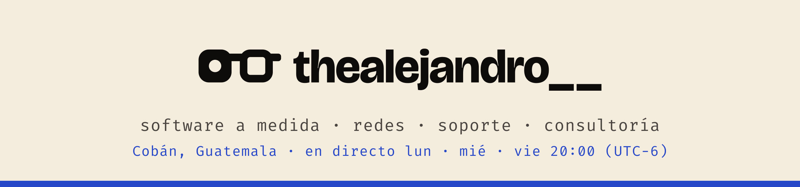
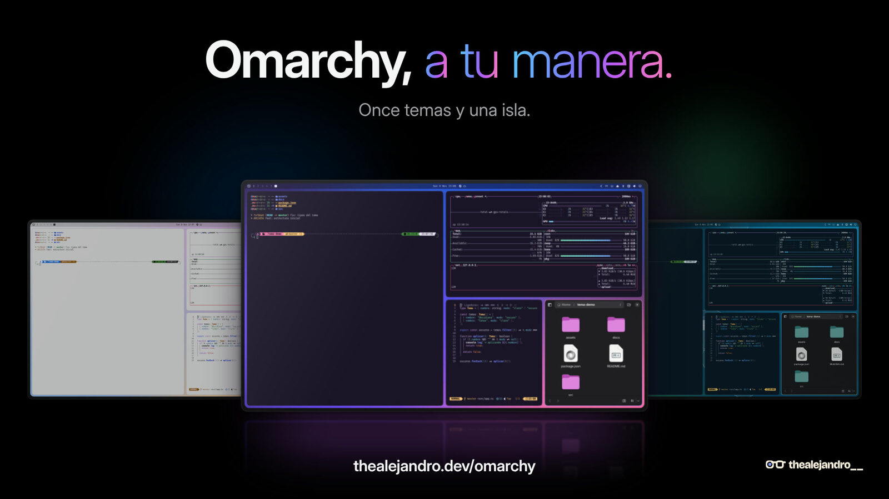

<a href="https://thealejandro.dev">
  <picture>
    <source media="(prefers-color-scheme: dark)" srcset="assets/banner-dark.png" />
    <source media="(prefers-color-scheme: light)" srcset="assets/banner-light.png" />
    
  </picture>
</a>

Me dedico a todo lo de informática: **desarrollo de software a medida, redes, soporte y consultoría**. Fundé [XACode](https://xacode.dev), donde construyo los productos xa·. Fuera del trabajo hago temas y plugins para [Omarchy](https://omarchy.org) y programo en directo en Twitch. Desde Cobán, Guatemala.

<p>
  <a href="https://thealejandro.dev"></a>
  <a href="https://thealejandro.dev/cv"></a>
  <a href="mailto:contact@thealejandro.dev"></a>
  <a href="https://linkedin.com/in/thealejandro"></a>
  <a href="https://twitch.tv/thealejandro__"></a>
  <a href="https://kick.com/thealejandro-tv"></a>
  <a href="https://instagram.com/thealejandro__"></a>
  <a href="https://x.com/thealejandro__"></a>
</p>

### Qué hago

| | |
| :--- | :--- |
| **Software a medida** | Sistemas web, APIs y automatizaciones con Laravel, Livewire y Astro. Rescate y modernización de sistemas heredados. |
| **Redes** | Redes cableadas e inalámbricas, servidores, Cloudflare y hosting. |
| **Soporte** | Equipos, mantenimiento preventivo y diagnóstico. |
| **Consultoría** | Tecnología para negocios y emprendedores. |

### Omarchy

<a href="https://thealejandro.dev/omarchy">
  
</a>

▶ [Ver el vídeo](https://thealejandro.dev/omarchy) · descarga del vídeo y el reel en la [release v2.0](https://github.com/thealejandro/omarchy-promo/releases/tag/v2.0)

- [**omarchy-themes**](https://github.com/thealejandro/omarchy-themes): 11 temas minimalistas inspirados en macOS y Windows, con esquinas redondeadas y colores para el prompt.
- [**omarchy-island**](https://github.com/thealejandro/omarchy-island): una isla dinámica que sale del reloj de la barra, con música, avisos, calendario, enfoque, clima y toggles rápidos.
- [**omarchy-screensaver-fx**](https://github.com/thealejandro/omarchy-screensaver-fx): más animaciones para el salvapantallas, con los colores de tu tema.
- [**omarchy-language**](https://github.com/thealejandro/omarchy-language): idioma del sistema y formatos regionales desde la barra.

```sh
omarchy plugin add https://github.com/thealejandro/omarchy-island.git --enable
```

### En XACode

| Producto | Qué es | Estado |
| :--- | :--- | :--- |
| [**xaSeguros**](https://seguros.xacode.dev) | Seguimiento de reclamos a aseguradoras | En producción |
| [**xaCare**](https://care.xacode.dev) | Gestión hospitalaria: pacientes, quirófano y honorarios | En producción |
| [**xaTiende**](https://xatiende.com) | Atención por WhatsApp con bandeja compartida, bot y asistente | Beta con pilotos |
| **xaLectorID** | Lectura del DPI de Guatemala para integrarla en tus sistemas | Disponible |
| **xaPagos** | Vouchers de pago, planilla y RR. HH. | Beta |
| **xaPedidos** | Pedidos en línea con marca propia para cada negocio | Próximamente |
| **xaFleet** | Gestión de flota vehicular | Próximamente |

Más en [xacode.dev](https://xacode.dev) y en [@XACodev](https://github.com/XACodev).

### En directo

Código, Linux y charla los **lunes, miércoles y viernes a las 20:00 (Guatemala, UTC−6)** en [Twitch](https://twitch.tv/thealejandro__) y [Kick](https://kick.com/thealejandro-tv).

### Stack

<p>
  
  
  
  
  
  
  
  
  
  
  
  
</p>
